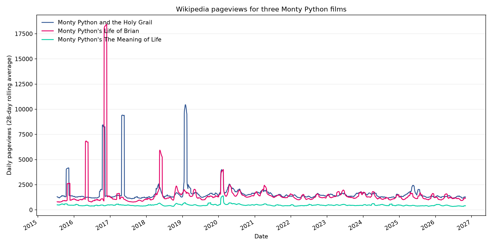
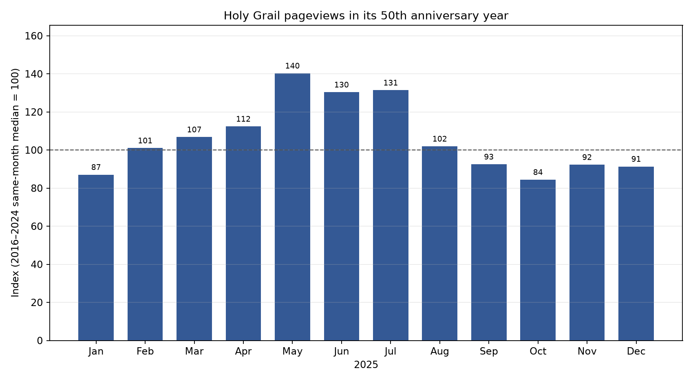
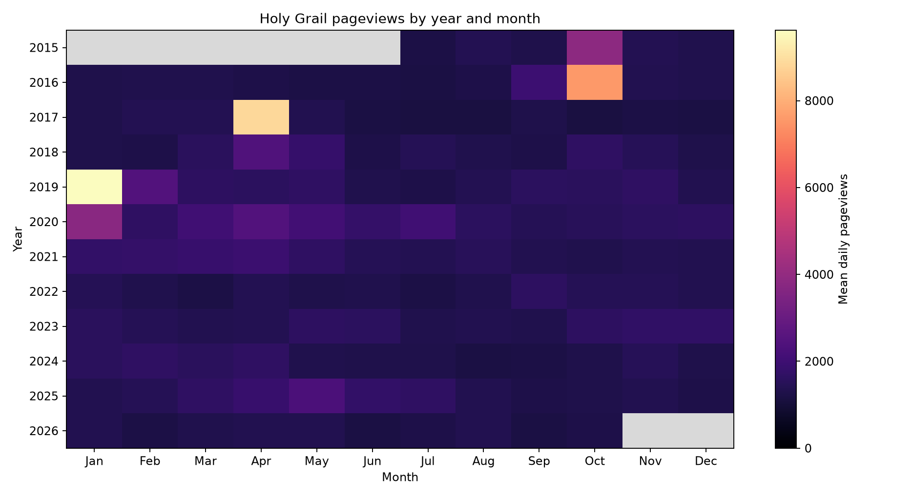

## A favorite film, measured a different way

*Monty Python and the Holy Grail* is my favorite movie, so I was curious about the film's place in popular culture. One trace of public attention is how often people look up a film's Wikipedia page. That led to my question: **How has English Wikipedia traffic for *Holy Grail* changed over time, and did its 50th anniversary coincide with a noticeable increase compared with two other Monty Python films?**

Pageviews cannot tell me how many people watched the movie, whether they liked it, or why they visited the page. They do provide a consistent daily measure of interest in the article, which makes a useful quantitative starting point.

## Collecting the data

I used Wikimedia's public [Pageviews Analytics API](https://doc.wikimedia.org/generated-data-platform/aqs/analytics-api/reference/page-views.html) to collect daily English Wikipedia pageviews for *Monty Python and the Holy Grail*, *Monty Python's Life of Brian*, and *Monty Python's The Meaning of Life*. The API has daily data beginning July 1, 2015. I requested the all-access `user` traffic category from that date through October 31, 2026, making one request at a time for each article.

The result is a tidy dataset with **12,423 article-day rows**: 4,141 dates for each of three film pages. Each row includes the article name and Wikipedia title, date, view count, year, month, weekday, and month start. The view count is numeric, and the date fields make it possible to compare days, months, and years. Wikimedia describes the data as page requests and filters traffic it classifies as spiders or automated agents, but that filter is still not a verified count of individual people.

To make a similar dataset, identify the exact Wikipedia article titles, choose a date range, and request each title from the API's per-article daily endpoint. I sent a descriptive User-Agent, followed the API access policy, and made sequential requests. Wikimedia releases Analytics API data under [CC0](https://doc.wikimedia.org/generated-data-platform/aqs/analytics-api/documentation/access-policy.html). The collection uses public aggregate traffic and does not collect names, account details, or page contents.

The Python script, requirements, full daily CSV, summaries, and charts are in my [separate analysis repository](https://github.com/jimna-h/mpathg-analysis). The script uses pandas for summaries and Matplotlib for figures. Run it with `uv sync` followed by `uv run python pageviews_analysis.py`. It retrieves fresh data and writes the results to `pageviews-analysis/`.

## What stands out

Across the full period, *Holy Grail* averaged about **1,667 pageviews per day**, with a median of **1,378**. *Life of Brian* averaged about **1,497** (median 1,188), while *The Meaning of Life* averaged about **476** (median 446). The gap between means and medians reflects a handful of unusually large days. For example, the largest daily count for *Life of Brian* was 259,598 on October 30, 2016; *Holy Grail* peaked at 155,427 on October 13, 2016. Those spikes stand out from typical daily traffic, and this analysis does not establish what caused them.

The 50th anniversary year offers a more focused comparison. I compared each 2025 calendar month's average daily views with the median for that same month during 2016–2024. *Holy Grail* was markedly above that reference in May, June, and July: roughly **40%, 30%, and 31% higher**, respectively. Several other months were near or below the reference, and the January–October 2025 average was a little below the corresponding historical-month average. This is a descriptive pattern, not evidence that the anniversary caused the midyear increase, since other events and ordinary variation could also explain it.

Comparing the three articles also shows why scale matters: the pages have different typical traffic levels, while rare spikes can dominate a plot. The raw monthly comparison retains the actual scale, and the indexed chart makes relative changes easier to see. A seasonality heatmap for *Holy Grail* shows monthly averages across years, but it does not explain the causes of any pattern.

## Limits and next questions

Wikipedia pageviews are not a measure of ticket sales, streaming, how many people watched a film, or public opinion. They cover English Wikipedia only, and automated-traffic classification is imperfect. The 2016 spikes deserve investigation before drawing conclusions: I could compare them with dated news or other events, while being careful not to treat coincidence as proof. I could also compare anniversary periods across all three films or look at other language editions.

For now, the data shows that *Holy Grail* continues to receive steady Wikipedia attention, with a midyear lift in its 50th anniversary year but no clear across-the-board jump. The API makes the traffic easy to collect and reproduce. Explaining why it changes is a separate question.

**Resources:** [Wikimedia Pageviews API](https://doc.wikimedia.org/generated-data-platform/aqs/analytics-api/reference/page-views.html) · [API access policy](https://doc.wikimedia.org/generated-data-platform/aqs/analytics-api/documentation/access-policy.html) · [Analysis code and data](https://github.com/jimna-h/mpathg-analysis)
